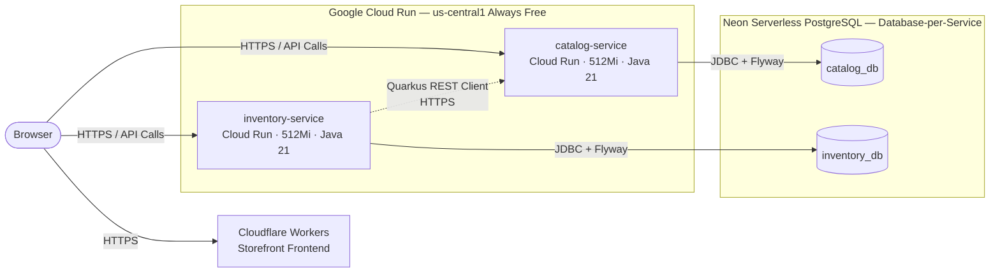

# Quantum Store PoC

Event-driven e-commerce Proof of Concept built with **Quarkus (Java 21)** microservices, a cloud-native web frontend, DevSecOps guardrails, and a **$0 serverless cloud architecture**.

## Architecture



### Live Endpoints
- **Frontend:** `https://quantum-store-poc.gbolanoscruz.workers.dev`
- **Catalog API:** `https://catalog-service-hlbrzrqapa-uc.a.run.app/api/catalog/products`
- **Inventory API:** `https://inventory-service-hlbrzrqapa-uc.a.run.app/api/inventory`

## Current Stack & Infrastructure

| Layer | Technology | Hosting / Cost |
| :--- | :--- | :--- |
| **Frontend** | Static HTML/JS *(Live catalog & inventory controls)* | Cloudflare Workers ($0) |
| **Backend** | Quarkus 3.40 LTS, Java 21, Panache, Flyway, REST Client, SmallRye Health/OpenAPI | Google Cloud Run — `us-central1` Always Free ($0) |
| **Container Registry** | Docker images *(cleanup policy: keep latest 2 versions)* | Google Artifact Registry — 0.5 GB Free Tier ($0) |
| **Databases** | PostgreSQL (*Database-per-Service*: `catalog_db`, `inventory_db`) | Neon Serverless ($0) |
| **CI/CD & Security** | GitHub Actions, OIDC (Workload Identity Federation), Trivy, CodeQL, Dependabot | GitHub ($0) |

## DevSecOps Controls
- **Branch Protection:** GitHub Rulesets enforced on `main` (Pull Request required, direct pushes blocked).
- **Keyless Cloud Auth:** **Workload Identity Federation (OIDC)** authenticates GitHub Actions to GCP with short-lived tokens — zero static SSH keys or JSON service account keys.
- **Vulnerability Scanning:** Automated **Trivy** filesystem & container image scans (`CRITICAL`/`HIGH`) blocking merges and Artifact Registry pushes.
- **Hardened Containers:** Multi-stage Alpine builds (`eclipse-temurin:21-jre-alpine`), build-time `apk upgrade --no-cache` patching, and non-root `quarkus` runtime user.
- **SAST & Dependency Hygiene:** **CodeQL** (Actions + Java) and **Dependabot** (`github-actions`, `maven`, `docker` across `/services/*`).
- **Managed TLS & Cost Guardrails:** Native Cloud Run HTTPS, scale-to-zero (`--min-instances=0`), `--max-instances=2`, Artifact Registry retention policy, and a $1 USD GCP billing alert.

## Repository Structure

```text
.
├── .github/workflows/       # CI/CD pipelines (Cloud Run OIDC), Trivy & CodeQL workflows
├── docs/                    # Infrastructure runbook and ADRs
├── frontend/                # Storefront static assets (deployed to Cloudflare Workers)
└── services/
    ├── catalog-service/     # Product catalog microservice (Quarkus + Neon)
    └── inventory-service/   # Stock & reservations microservice (Quarkus + REST Client + Neon)
```

## Documentation
- [Infrastructure Runbook](docs/infrastructure-runbook.md) — Google Cloud Run, Artifact Registry, Workload Identity Federation, Neon, and Cloudflare Workers setup.
- [Security Policy](SECURITY.md) — Active DevSecOps controls and vulnerability reporting process.
- [ADR-001: Hybrid Zero-Cost Infrastructure](docs/adr/001-hybrid-zero-cost-infra.md) *(Superseded by ADR-004)*
- [ADR-002: Fixed HTTPS with DuckDNS & Caddy](docs/adr/002-fixed-https-duckdns-caddy.md) *(Superseded by ADR-004)*
- [ADR-003: Standardize Backend Microservices on Quarkus (Java 21 LTS)](docs/adr/003-microservices-stack-quarkus.md)
- [ADR-004: Migrate Backend Microservices to Google Cloud Run](docs/adr/004-migrate-backend-to-cloud-run.md)

## Roadmap
- [x] Monorepo setup + DevSecOps guardrails (Rulesets, Trivy, CodeQL, Dependabot)
- [x] Zero-cost serverless architecture (Cloudflare Workers + Google Cloud Run + Neon + OIDC)
- [x] Core microservices — Phase 1 (`catalog-service` & `inventory-service` with DB-per-service & REST Client)
- [x] Live storefront with real-time inventory reservations
- [ ] Core microservices — Phase 2 (`orders-service` & `payments-service`)
- [ ] Event-driven messaging & observability

---
**Built with 💻 by Gustavo Bolaños**