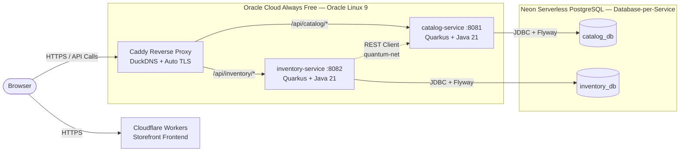

# Quantum Store PoC

Event-driven e-commerce Proof of Concept built with **Quarkus (Java 21)** microservices, a cloud-native web frontend, DevSecOps guardrails, and a **$0 hybrid cloud architecture**.

## Architecture



### Live Endpoints
- **Frontend:** `https://quantum-store-poc.gbolanoscruz.workers.dev`
- **Catalog API:** `https://quantum-store-api.duckdns.org/api/catalog/products`
- **Inventory API:** `https://quantum-store-api.duckdns.org/api/inventory`

## Current Stack & Infrastructure

| Layer | Technology | Hosting / Cost |
| :--- | :--- | :--- |
| **Frontend** | Static HTML/JS *(Catalog storefront)* | Cloudflare Workers ($0) |
| **Backend** | Quarkus 3.40 LTS, Java 21, Panache, Flyway, REST Client, SmallRye Health/OpenAPI | Oracle Cloud Always Free `VM.Standard.E2.1.Micro` ($0) |
| **Databases** | PostgreSQL (*Database-per-Service*: `catalog_db`, `inventory_db`) | Neon Serverless ($0) |
| **Reverse Proxy & TLS** | Caddy + Let's Encrypt + DuckDNS | Self-hosted in Docker on OCI ($0) |
| **CI/CD & Security** | GitHub Actions, GHCR, Trivy, CodeQL, Dependabot | GitHub ($0) |

## DevSecOps Controls
- **Branch Protection:** GitHub Rulesets enforced on `main` (Pull Request required, direct pushes blocked).
- **Vulnerability Scanning:** Automated **Trivy** filesystem & container image scans (`CRITICAL`/`HIGH`) blocking merges and GHCR pushes.
- **Hardened Containers:** Multi-stage Alpine builds (`eclipse-temurin:21-jre-alpine`), non-root `quarkus` runtime user, and `apk upgrade` patching at build time.
- **SAST & Dependency Hygiene:** **CodeQL** (Actions + Java) and **Dependabot** (`github-actions`, `maven`, `docker` across `/services/*`).
- **Least-Privilege Networking:** Only ports `80` and `443` exposed publicly via OCI Security Lists; services bind to `127.0.0.1` behind Caddy and communicate internally over the private `quantum-net` Docker network.
- **Serialized Deployments:** Global `concurrency` queue (`oci-deploy`) prevents simultaneous SSH/Docker deployment collisions on the 1 GB RAM VM.

## Repository Structure

```text
.
├── .github/workflows/       # CI/CD pipelines, Trivy & CodeQL security workflows
├── docs/                    # Infrastructure runbooks and ADRs
├── frontend/                # Storefront static assets (deployed to Cloudflare)
└── services/
    ├── catalog-service/     # Product catalog microservice (Quarkus + Neon)
    └── inventory-service/   # Stock & reservations microservice (Quarkus + REST Client + Neon)
```

## Documentation
- [Infrastructure Runbook](docs/infrastructure-runbook.md) — OCI setup, Oracle Linux 9 tuning (swap, `firewalld` + Docker), and Caddy HTTPS configuration.
- [Security Policy](SECURITY.md) — Active DevSecOps controls and vulnerability reporting process.
- [ADR-001: Hybrid Zero-Cost Infrastructure](docs/adr/001-hybrid-zero-cost-infra.md)
- [ADR-002: Fixed HTTPS with DuckDNS & Caddy](docs/adr/002-fixed-https-duckdns-caddy.md)
- [ADR-003: Standardize Backend Microservices on Quarkus (Java 21 LTS)](docs/adr/003-microservices-stack-quarkus.md)

## Roadmap
- [x] Monorepo setup + DevSecOps guardrails (Rulesets, Trivy, CodeQL, Dependabot)
- [x] Zero-cost hybrid deployment (Cloudflare + Oracle Cloud + GHCR)
- [x] Fixed HTTPS endpoint (DuckDNS + Caddy)
- [x] Core microservices — Phase 1 (`catalog-service` & `inventory-service` with Neon DB-per-service & internal REST Client)
- [ ] Core microservices — Phase 2 (`orders-service` & `payments-service`)
- [ ] Frontend stock integration & modern storefront migration
- [ ] Event-driven messaging & observability

---
**Built with 💻 by Gustavo Bolaños**