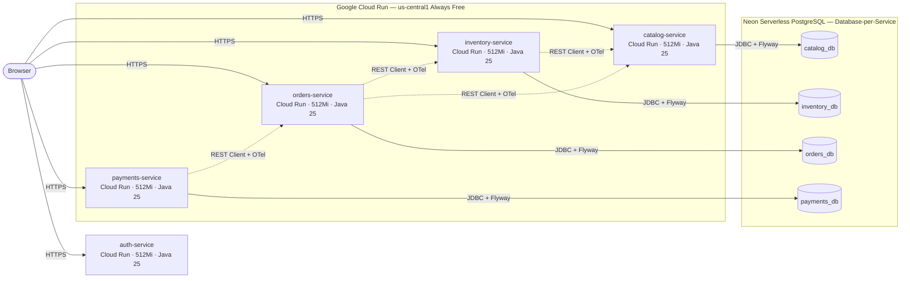

# Quantum Store PoC

[](https://github.com/gbolanoscruz/quantum-store-poc/actions/workflows/ci-tests.yml)
[](https://github.com/gbolanoscruz/quantum-store-poc/actions/workflows/security-scan.yml)
[](LICENSE)

Cloud-native e-commerce Proof of Concept built with **Quarkus (Java 25 LTS)** microservices, a live web storefront, automated integration testing, built-in observability, DevSecOps guardrails, and a **$0 serverless cloud architecture**.

## Architecture



### Live Endpoints
- **Frontend:** `https://quantum-store-poc.gbolanoscruz.workers.dev`
- **Catalog API:** `https://catalog-service-hlbrzrqapa-uc.a.run.app/api/catalog/products`
- **Inventory API:** `https://inventory-service-hlbrzrqapa-uc.a.run.app/api/inventory`
- **Orders API:** `https://orders-service-hlbrzrqapa-uc.a.run.app/api/orders`
- **Payments API:** `https://payments-service-hlbrzrqapa-uc.a.run.app/api/payments`
- **Auth API:** `https://auth-service-hlbrzrqapa-uc.a.run.app/api/auth` (/register, /login, /google, /me)


*(Every microservice also exposes `/q/health/ready`, `/q/metrics`, and `/q/openapi`).*

## Tech Stack & Infrastructure

| Layer | Technology | Hosting / Cost |
| :--- | :--- | :--- |
| **Frontend** | Vanilla HTML, CSS & JS *(live catalog, stock, orders, payments & refunds)* | Cloudflare Workers ($0) |
| **Backend** | Quarkus 3.40 LTS, Java 25 LTS, Panache, Flyway, REST Client, SmallRye Health/OpenAPI | Google Cloud Run — `us-central1` Always Free ($0) |
| **Container Registry** | Hardened Alpine Docker images *(retention: keep latest 2 versions)* | Google Artifact Registry — 0.5 GB Free Tier ($0) |
| **Databases** | PostgreSQL (*Database-per-Service*: `catalog_db`, `inventory_db`, `orders_db`, `payments_db`, `auth_db`) | Neon Serverless ($0) |
| **Testing** | Maven multi-module, JUnit 5, RestAssured, Mockito, Quarkus Dev Services | GitHub Actions ($0) |
| **Observability** | GCP Structured JSON Logging, OpenTelemetry (`traceparent`), Micrometer Prometheus (`/q/metrics`) | Google Cloud Logging Free Tier ($0) |
| **CI/CD & Security** | GitHub Actions, OIDC (Workload Identity Federation), Trivy, CodeQL, Dependabot | GitHub ($0) |

## Testing & Local Development

The monorepo uses a root Maven aggregator (`pom.xml`) paired with **Quarkus Dev Services**. When test suites are present, Quarkus can spin up ephemeral PostgreSQL containers in Docker and run Flyway migrations automatically without needing cloud credentials.

**Prerequisites:** Java 25 LTS, Apache Maven 3.9+, and Docker running locally.

```bash
# Run the full test suite across all 4 microservices
mvn test

# Run tests for a single microservice
mvn -pl services/orders-service test

# Dev mode for a single microservice
mvn -f services/orders-service/pom.xml quarkus:dev
```

## Observability

All four microservices include zero-cost, cloud-native observability:
- **Structured JSON Logs (`quarkus-logging-json`):** Uses the `gcp` log format in production so Google Cloud Logging parses severity, service name, and trace metadata automatically (disabled in `dev` and `test` for readable console output).
- **Distributed Trace Propagation (`quarkus-opentelemetry`):** Propagates W3C `traceparent` headers across `payments` → `orders` → `inventory` → `catalog` and includes `traceId` and `spanId` in log entries.
- **Technical & Business Metrics (`quarkus-micrometer-registry-prometheus`):** Exposes `/q/metrics` with JVM, HTTP, and JDBC pool metrics alongside custom business counters (`quantum_orders_total` and `quantum_payments_total`).

## DevSecOps Controls
- **Branch Protection:** GitHub Rulesets enforced on `main` (Pull Request required, direct pushes blocked, required status checks enforced).
- **Keyless Cloud Auth:** **Workload Identity Federation (OIDC)** authenticates GitHub Actions to GCP with short-lived tokens — no static SSH keys or JSON service account keys.
- **Vulnerability Scanning:** Automated **Trivy** filesystem & container image scans (`CRITICAL`/`HIGH`) blocking merges and Artifact Registry pushes.
- **Hardened Containers:** Multi-stage Alpine builds (`eclipse-temurin:25-jre-alpine`), build-time `apk upgrade --no-cache` patching, and non-root `quarkus` runtime user.
- **SAST & Dependency Hygiene:** **CodeQL** (Actions + Java) and **Dependabot** (`github-actions`, `maven`, `docker` across `/services/*`).
- **Managed TLS & Cost Guardrails:** Native Cloud Run HTTPS, scale-to-zero (`--min-instances=0`), `--max-instances=2`, Artifact Registry retention policy, and a $1 USD GCP billing alert.

## Repository Structure

```text
.
├── .github/workflows/       # CI test matrix, Cloud Run OIDC deploys, Trivy & CodeQL
├── docs/                    # Infrastructure runbook and ADRs
├── frontend/
│   ├── index.html           # Storefront semantic markup
│   ├── styles.css           # Layout & dark theme styles
│   └── app.js               # Safe DOM rendering & API orchestration
├── services/
│   ├── catalog-service/     # Product catalog microservice (Quarkus + Neon)
│   ├── inventory-service/   # Stock & reservations microservice (Quarkus + REST Client + Neon)
│   ├── orders-service/      # Order orchestration & stock compensation (Quarkus + REST Clients + Neon)
│   └── payments-service/    # Payment capture, decline simulation & cascading refunds (Quarkus + Neon)
└── pom.xml                  # Root Maven multi-module aggregator
```

## Documentation
- [Infrastructure Runbook](docs/infrastructure-runbook.md) — Google Cloud Run, Artifact Registry, Workload Identity Federation, Neon, Cloudflare Workers, and observability verification.
- [Contributing Guide](CONTRIBUTING.md) — Branching rules, microservice standards, testing workflow, and PR checks.
- [Security Policy](SECURITY.md) — Active DevSecOps controls and vulnerability reporting process.
- [ADR-001: Hybrid Zero-Cost Infrastructure](docs/adr/001-hybrid-zero-cost-infra.md) *(Superseded by ADR-004)*
- [ADR-002: Fixed HTTPS with DuckDNS & Caddy](docs/adr/002-fixed-https-duckdns-caddy.md) *(Superseded by ADR-004)*
- [ADR-003: Standardize Backend Microservices on Quarkus](docs/adr/003-microservices-stack-quarkus.md)
- [ADR-004: Migrate Backend Microservices to Google Cloud Run](docs/adr/004-migrate-backend-to-cloud-run.md)

## Roadmap
- [x] Monorepo setup + DevSecOps guardrails (Rulesets, Trivy, CodeQL, Dependabot)
- [x] Zero-cost serverless architecture (Cloudflare Workers + Google Cloud Run + Neon + OIDC)
- [x] Core microservices — Phase 1 (`catalog-service` & `inventory-service` with DB-per-service & REST Client)
- [x] Core microservices — Phase 2 (`orders-service` & `payments-service` with orchestration & cascading compensation)
- [x] Live storefront with real-time stock, orders, payments & refunds
- [x] Automated integration testing (Maven multi-module, Quarkus Dev Services & GitHub Actions CI)
- [x] Native observability (GCP JSON logging, OpenTelemetry trace propagation & Prometheus metrics)
- [x] User sessions with JWT, email/password auth, and Google Sign-In
- [ ] Event-driven async messaging (optional next phase)

---
**Built with 💻 by Gustavo Bolaños**