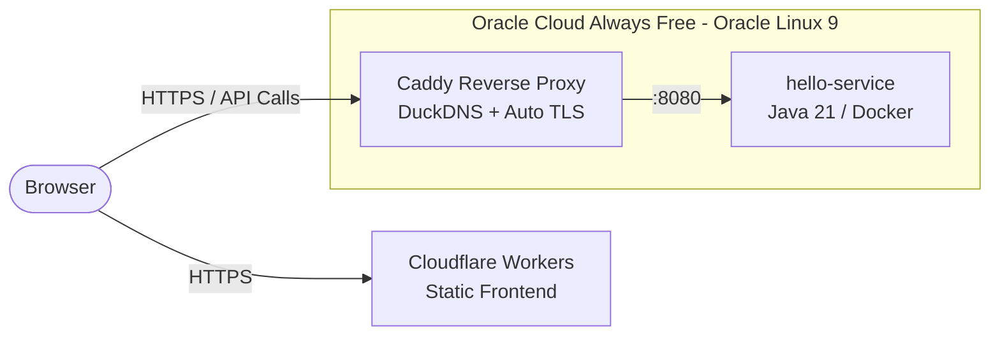

# Quantum Store PoC

Event-driven e-commerce Proof of Concept built with Java microservices, a modern web frontend, DevSecOps guardrails, and a **$0 hybrid cloud architecture**.

## Architecture



### Live Endpoints
- **Frontend:** `https://quantum-store-poc.gbolanoscruz.workers.dev`
- **Backend API (Health / Hello):** `https://quantum-store-api.duckdns.org/api/hello`

## Current Stack & Infrastructure

| Layer | Technology | Hosting / Cost |
| :--- | :--- | :--- |
| **Frontend** | Static HTML/JS *(PoC skeleton)* | Cloudflare Workers ($0) |
| **Backend** | Java 21 (Docker multi-stage, Eclipse Temurin Alpine) | Oracle Cloud Always Free `VM.Standard.E2.1.Micro` ($0) |
| **Reverse Proxy & TLS** | Caddy + Let's Encrypt + DuckDNS | Self-hosted in Docker on OCI ($0) |
| **CI/CD & Security** | GitHub Actions, Trivy, CodeQL, Dependabot | GitHub ($0) |

## DevSecOps Controls
- **Branch Protection:** GitHub Rulesets enforced on `main` (Pull Request required, direct pushes blocked).
- **Vulnerability Scanning:** Automated **Trivy** filesystem/container scan configured as a required status check on every PR.
- **SAST & Dependency Hygiene:** **CodeQL** (Actions + Java) and **Dependabot** enabled.
- **Least-Privilege Networking:** Only ports `80` and `443` exposed publicly via OCI Security Lists; internal services stay bound behind Caddy.

## Repository Structure

```text
.
├── .github/workflows/   # CI/CD and Trivy security workflows
├── docs/                # Infrastructure runbooks and ADRs
├── frontend/            # Storefront static assets (deployed to Cloudflare)
└── services/
    └── hello-service/   # Initial Java 21 Dockerized microservice
```

## Documentation
- [Infrastructure Runbook](docs/infrastructure-runbook.md) — OCI setup, Oracle Linux 9 tuning (swap, `firewalld` + Docker), and Caddy HTTPS configuration.
- [Security Policy](SECURITY.md) — Active DevSecOps controls and vulnerability reporting process.
- [ADR-001: Hybrid Zero-Cost Infrastructure](docs/adr/001-hybrid-zero-cost-infra.md)
- [ADR-002: Fixed HTTPS with DuckDNS & Caddy](docs/adr/002-fixed-https-duckdns-caddy.md)

## Roadmap
- [x] Monorepo setup + DevSecOps guardrails (Rulesets, Trivy, CodeQL)
- [x] Zero-cost hybrid deployment (Cloudflare + Oracle Cloud)
- [x] Fixed HTTPS endpoint (DuckDNS + Caddy)
- [ ] Core microservices architecture (Catalog, Orders, Inventory, Payments)
- [ ] Modern frontend migration
- [ ] Event-driven messaging & observability

---
**Built with 💻 by Gustavo Bolaños**